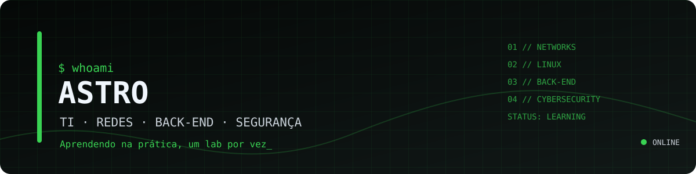
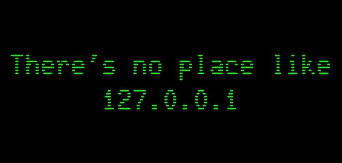

  

<h1 align="center">Hello, I am Astro</h1>

<h3 align="center">IT · Networks · Back-End · Security</h3>

<code>One step time...</code>

  Reliable systems. Solid infrastructure. Clean code. Nothing else.

---

<h2 align="center">About me</h2>

<b>Astro</b>, Software Engineering student — obsessed with infrastructure, networking, and back-end.

I learn by getting my hands dirty: I set up labs, automate chaos, and build battle-tested systems to solve real-world IT challenges.

Right now, I’m diving deep into <b>Node.js, databases, Docker, Linux, and information security</b> — pecifically penetration testing and CTFs, where silence speaks volumes.

My goal is simple and uncompromising: to write clean code, maintain resilient infrastructure, and become a well-rounded professional—covering <b>Dev, Infra, and Sec</b>. No shortcuts. No excuses.

  

---

<h2 align="center">Conect</h2>

  
  

---

<h2 align="center">💻 Tech Stack</h2>

  

---

<h2 align="center">📊 GitHub Stats</h2>

  

---

<h2 align="center">📈 Activity Graph</h2>

  

---

<h2 align="center">🐍 Cobrinha</h2>

<picture>
  <source media="(prefers-color-scheme: dark)" srcset="https://raw.githubusercontent.com/AstroCx1-env/AstroCx1-env/output/github-snake-dark.svg" />
  
</picture>

“Todo profissional já foi um iniciante que não desistiu.”

